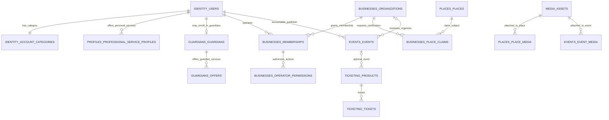

# VibeQuestGuardians — Database.md

**Design source:** `funmarket/VibeQuestGuardians`, branch `vibefoundation`, Requirements.md (blob `5635346255d200dd1b5d4d86d6867a777f7622ff`), structure.md (blob `576a844c0a698a9cc3b512ecde8caaaeab5f0471`), and the 28-domain register. This document and `Schema.sql` are one consistent design delivery. No database or code implementation is claimed.

## 1. Exact approved account rules

The only user account categories are **Vibe**, **Pro**, and **Business**. `identity.account_categories` uses exactly `vibe`, `pro`, `business`, default `vibe`. Each person has one D01 user ID. Account selection does not grant professional verification, business ownership, paid services, or Event-publishing authority.

- **Vibe:** regular member; can browse and use approved social, community Activity and free Trail features subject to authentication and relevant consent.
- **Pro:** an individual professional who may publish eligible Events, offer personal services (singer, photographer, artist, planner, and other eligible services), and optionally apply inside **Vibe Guardians** for a Guardian service profile. **Pro Guardian is a service/qualification managed by D07, never a user role.** Local Legend likewise is a Guardian-feature qualification, not an account category.
- **Business:** an account category for a business owner/operator. Actual legal organizations, members and operator privileges are D09 records. Authorized Business operators may publish Events and claim/manage certified Business Places, subject to approval; no Business category selection can certify a Place.

D01 does **not** store Guardian qualification or a second list of professional account roles. D02 owns descriptions of general personal-service offerings; D07 owns Guardian eligibility, freshness, specific Guardian offers and hire access. D09 owns organizations/claims, D05 canonical Places, D11 Events, D25 applicable subscriptions and D28 independent Tickets.

## 2. Physical organization and data ownership

PostgreSQL namespaces make logical single-writer boundaries. **They are not 28 deployed databases or 28 services.** Each domain owns tables and domain commands; other domains communicate through authenticated application contracts. Database schema names are organizational, not a substitute for restricted SQL principals/grants. The system uses relational keys for identity and canonical records, with spatial PostGIS geometry for Places and consented Geo. D13 records media metadata and asset keys while bytes belong in access-controlled object storage; owner domains govern attachment meaning.

## 3. Exact table inventory generated from Schema.sql

**113 named tables** in **28 business schemas plus one technical infrastructure schema**. Each declared foreign-key target is defined; this alone does not prove service-level eligibility or transactional correctness.

| Domain | SQL schema | Defined tables |
|---|---|---|
| D01 Identity and Authentication | `identity` | `users`, `account_categories`, `login_methods`, `sessions`, `recovery_tokens`, `account_audit` |
| D02 Profiles and Personal Preferences | `profiles` | `profiles`, `preferences`, `professional_service_profiles`, `professional_service_media`, `user_languages` |
| D03 Social Graph | `social_graph` | `follows`, `blocks` |
| D04 Geo and Presence | `geo` | `consents`, `positions`, `geofences`, `presence_sessions`, `geofence_alerts` |
| D05 Places and Contributions | `places` | `places`, `checkins`, `validations`, `contributions`, `bookmarks`, `place_media` |
| D06 Vibe Trails | `trails` | `trails`, `versions`, `stops`, `remix_links`, `user_saves`, `completions`, `version_media` |
| D07 Guardians and Local Legends | `guardians` | `guardians`, `offers`, `featured_trails`, `applications`, `service_media`, `selfie_reviews` |
| D08 Tours and Guardian Reservations | `tours` | `tours`, `slots`, `requests`, `booking_history` |
| D09 Businesses and Organizations | `businesses` | `organizations`, `memberships`, `place_claims`, `organization_media`, `claim_history`, `operator_permissions` |
| D10 Activities | `activities` | `activities`, `participation`, `attendance` |
| D11 Events | `events` | `events`, `rsvps`, `event_media`, `event_discussions`, `organizer_decisions` |
| D12 Social Content | `content` | `posts`, `reactions`, `comments`, `content_saves`, `post_media` |
| D13 Global Media | `media` | `assets`, `attachments`, `derivatives`, `cleanup_jobs`, `access_grants` |
| D14 Messaging | `messaging` | `conversations`, `members`, `messages`, `receipts` |
| D15 Live Rooms | `rooms` | `sessions`, `participants` |
| D16 Communities and Circles | `communities` | `communities`, `members`, `invitations` |
| D17 Matching and Connections | `matching` | `proposals`, `acceptances` |
| D18 Challenges | `challenges` | `challenges`, `responses`, `reactions` |
| D19 Recognition and Reputation | `recognition` | `badges`, `guardian_reviews`, `passport_stamps` |
| D20 VQ Rewards and Ledger | `vq` | `rules`, `accounts`, `journals`, `entries`, `grant_batches`, `grant_recipients`, `posting_requests` |
| D21 Moderation and Trust | `moderation` | `reports`, `actions`, `appeals` |
| D22 Encounter Handshakes | `handshakes` | `agreements`, `history` |
| D23 Notifications | `notifications` | `inbox`, `delivery_attempts` |
| D24 Advertising | `advertising` | `campaigns`, `placements`, `impressions` |
| D25 Subscriptions and Entitlements | `subscriptions` | `entitlements`, `subscription_periods` |
| D26 Marketplace | `marketplace` | `listings`, `deals`, `deal_messages` |
| D27 Payments and Billing | `billing` | `payments`, `refunds` |
| D28 Ticketing | `ticketing` | `products`, `tickets`, `redemptions`, `issuance_requests` |
| Technical infrastructure only | `platform` | `outbox`, `inbox`, `audit_events` |

## 4. Selected relational view

**Diagram semantics:** Individual Pro Event organizer is represented in `events.events.pro_organizer_id`, while Business Event organizer is `business_organizer_id`. Exactly one is required; the accountable human is `publisher_user_id`. Those fields describe *the publication actor and represented principal*, not verified permission. Cross-record authorization must confirm the current category or active Business operator authority, valid entity status and any applicable D25 entitlement. No Guardian service grants Event publishing automatically.

## 5. Boundaries and non-negotiable invariants

| Flow | Record owner | Required enforcement |
|---|---|---|
| User roles and sessions | D01 | Exactly three category values; distinct session credentials; no self-approval |
| Individual professional service | D02 | Pro category plus authorized profile state; no Guardian qualifications here |
| Guardian listing and paid Tour eligibility | D07 + D08 | Eligible Pro account for paid Guardian services; D07 review, fresh in-app selfie, entitlement; D08 transactional capacity and acceptance |
| Business Place certification | D09 + D05 | Active operator rights and approved claim; canonical Place publication stays D05 |
| Official Events | D11 | Qualified Pro or verified/authorized Business principal; prevent category-only publication |
| Tickets | D28 | Event link optional; issuer authorization; unique issued token hash; single redemption and transactional inventory |
| Media | D13 and consumer | Asset status/retention and feature-specific access; private files not publicly joinable |
| Handshake | D22 | One idempotent accepted in-app Guardian/Legend engagement, not physical GPS proof |
| VQ | D20 | Verified origin and approved active reward rule, idempotent balanced postings and audit; no crypto or separate Points |
| Messaging and rooms | D14/D15/D16 | Authorized participants, real delivery state, block/membership enforcement |
| Geo and Find Hub | D04 | Explicit opt-in; two-hour temporary live position limit and revocation |
| VibeCheck / VibeFlash | D18 | Server deadlines 180/33 seconds and real media capture, 24-hour lifecycle |
| Marketplace and billing | D26/D27 | Genuine seller agreement vs separate real-money payment; no invented escrow or commission |

## 6. SQL execution boundaries

`Schema.sql` defines the **physical DDL design**: schemas, tables, keys, checks and indexes. It does not falsely claim to implement service authorization, storage-provider IAM, all domain transitions, card payments or server-command logic. Such authorization must be specified and tested in implementation before accepting any deployment. **Do not deploy the DDL merely because it parses.** This distinction neither changes the agreed user roles nor introduces additional product approval questions. The companion schema is the only SQL document for this review.

## 7. Review evidence and limitations

The SQL/table-inventory cross-check found **113 unique table identifiers**, **194 declared FK references**, **zero missing FK target tables**, **exactly three account category values**, and **no `pro_guardian` Identity role/capacity identifier**. Static analysis is not a PostgreSQL server run. A full feature-by-feature source-to-SQL semantic audit and server-side command/RLS test suite were not executed here; consequently **runtime and complete implementation acceptance are not claimed**. No GitHub, database or deployment mutation is authorized or performed by this document's creation.
