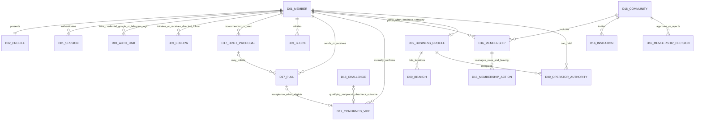
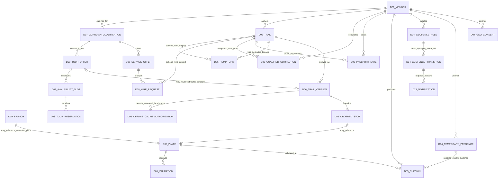
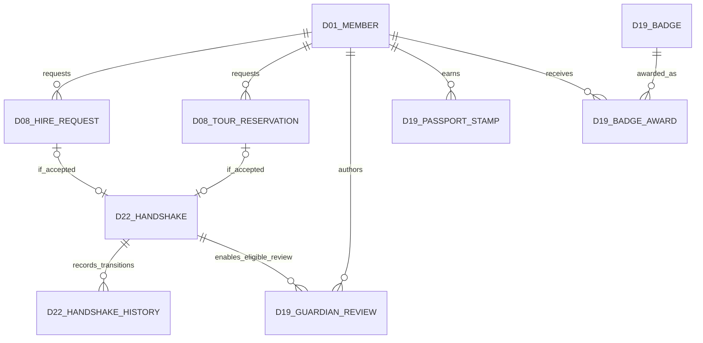
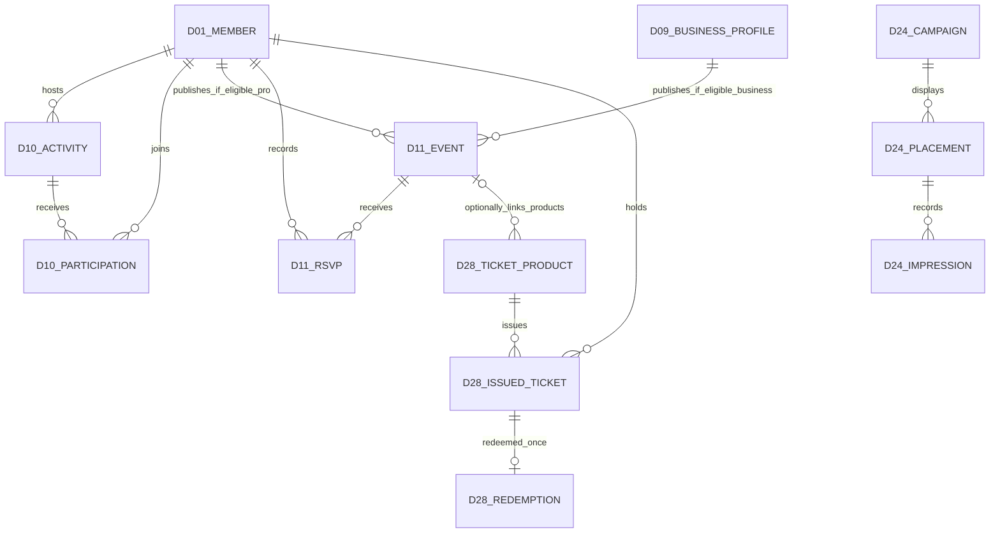
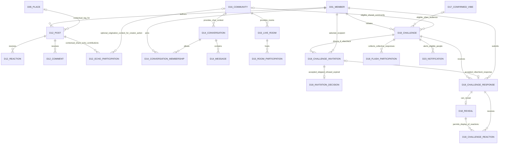
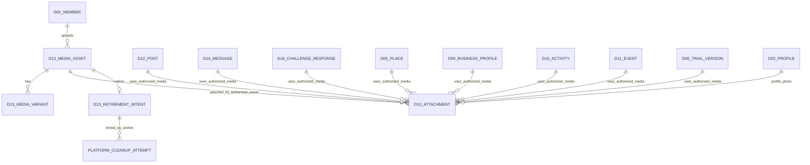
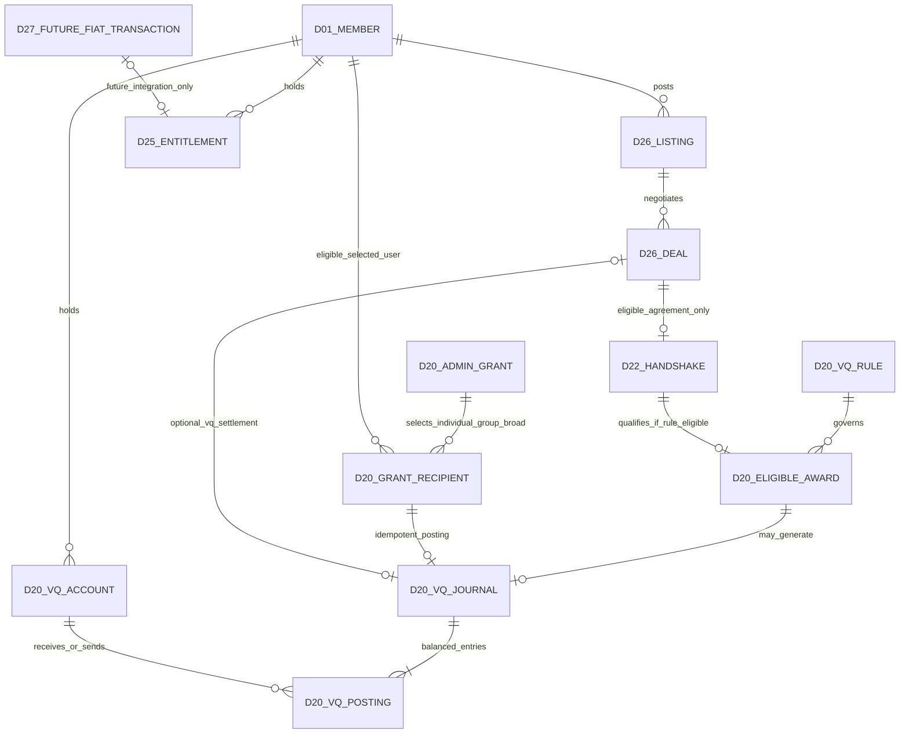
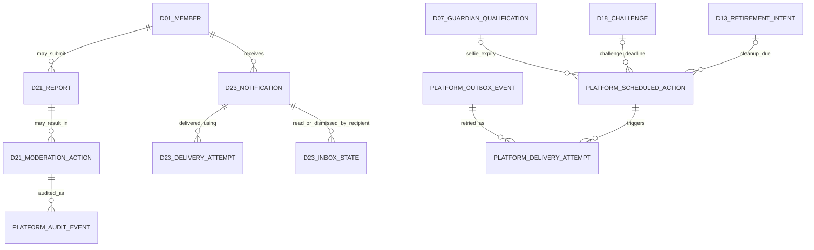

# VibeQuestGuardians — Conceptual Database Architecture and ER Diagrams

**Status:** **PRODUCT OWNER APPROVED CONCEPTUAL DATABASE / PERSISTENCE BASELINE.** This document defines approved conceptual ownership, persistence relationships and invariants. It is NOT an executable schema, migration, installed database state, or permission to provision/mutate infrastructure. Historical Gemini ZIP and old VibeQuest GitHub are interaction evidence, not schema authorities. Latest explicit owner decisions supersede conflicting older drafts.

# Post-Baseline Persistence Updates — Master Plan Controlled

> **Authority notice:** This document remains the Product Owner-approved conceptual persistence/invariant baseline. Newer explicit Product Owner decisions and the approved Master Plan persistence/operational clarifications control implementation where they supersede conflicting, incomplete, OPEN/UNSPECIFIED or absent older wording. These additions are conceptual ownership/persistence requirements, not executable SQL or physical table mandates.

## Database Delta A — Additive operational records do not create new domains

Additional physical/operational records required by the approved Master Plan do **not** create new business domains. They belong to the existing canonical D01–D28 owner or to explicitly cross-cutting platform/audit infrastructure.

> **Admin Control Room is not D29.** Its screens/application orchestration may have dedicated modules and cross-cutting audit/operations persistence, but canonical records remain owned by D01–D28. Admin commands invoke those owners rather than maintaining shadow copies or second-writer tables.

## Database Delta B — D01 Admin authorization persistence

D01 conceptually owns durable Admin authorization associations required by the final Control Room, including Admin role/capability assignments, effective status, revocation and appropriate privileged-session/security metadata. Exact physical tables/types remain implementation work; D01 remains identity/auth owner.

## Database Delta C — D21 moderation / Trust & Safety persistence

D21 conceptually requires durable records for:

- **Report:** reporter, reported subject/reference, reason/category, optional explanation, safely permitted evidence references, submitted time and status.
- **Case:** case identity, severity/priority, status, assignment, linked reports, subject, investigation metadata and resolution. Duplicate reports may link/merge to one incident/case rather than multiplying sanctions.
- **Decision:** finding, reason, authorized actor, timestamp and linked evidence/source.
- **Strike:** subject user, strike sequence, policy category, source case, issued time and active/overturned/final disposition state. A report alone does not create this record.
- **Restriction:** capability/scope, start, expiry where temporary, reason, source case and current state.
- **Suspension/Ban:** selected standard duration/state, start/end where temporary, Permanent state where applicable, reason and source case.
- **Appeal:** sanction reference, submitted time, appeal reason/evidence, reviewer, outcome, outcome reason and resolved time.
- **Case history/audit:** immutable lifecycle/change events sufficient to explain triage, assignment, evidence review, action, appeal and closure.

D21 owns these sanction/case facts; source domains retain their own business/content records and enforce D21 restrictions through authorized interfaces.

## Database Delta D — D20 VQ operational persistence

D20 persistence must account conceptually for versioned reward rules and activation/effective time; grant batches; recipient criteria/outcomes; idempotency; immutable ledger postings; compensating corrections instead of history rewrite; source-event references; and privileged Admin/audit linkage where appropriate. D20 remains the sole VQ ledger writer.

## Database Delta E — D05 confidence-policy persistence

D05 conceptually owns versioned confidence-policy state including configuration payload/parameters, effective-from time, status, provenance/authorized actor, active version and confidence-result provenance. Historical validation observations remain immutable when policy changes; current result provenance identifies the policy version used. D05 remains the canonical confidence writer.

## Database Delta F — D22 Handshake lifecycle

The conceptual D22 model must represent a unique/idempotent qualifying source agreement reference, participants, `issued_at`, `expires_at`, state limited to **ACTIVE/EXPIRED**, review-eligibility proof and review-use linkage/reference as appropriate. There is **no CANCELLED Handshake state**. Server-authoritative expiry occurs exactly 24 hours after issuance and survives restart. Underlying source booking/deal cancellation does not revoke/reset/delete/extend the Handshake.

## Database Delta G — D26 Marketplace review

D26 conceptually owns Marketplace product/deal-item review persistence: reviewed listing/deal item, reviewer, qualifying D26 agreement/deal, qualifying D22 Handshake reference, rating/content, created time, moderation state and a uniqueness rule preventing duplicate review for the same eligibility source. D22 remains eligibility proof only. This review record does not prove physical handover, authenticity, quality or payment. D19 remains the separate Guardian/provider reputation-review owner where applicable.

## Database Delta H — Privileged Admin audit infrastructure

Cross-cutting privileged audit persistence may record actor, validated capability/role, target type/ID, linked case/report where relevant, action, reason, previous/new state reference where appropriate, owning-domain command, timestamp, correlation/causation ID and result/failure. This is audit infrastructure, **not D29 and not a second writer** of the underlying business fact.

## Database Delta I — Support / operational case references

If implementation uses support-case records separate from D21 misconduct cases, ownership must remain explicit and narrow. Support/operations metadata may reference canonical account, reservation, VQ posting, ticket, Place, Guardian eligibility, notification/media job or Marketplace deal records. Corrections still execute through those owning domains; no generic Admin table may become a shadow source of truth.

## Database Delta J — Durable temporary-sanction expiry

Temporary restrictions/suspensions require a durable server-authoritative due time and reconciliation path that survives process/Redis restart. Browser timers, process memory or Redis TTL alone are insufficient authoritative state. Standard temporary choices are 3 days, 1 week, 1 month and 3 months; Permanent has no automatic expiry.

## Approved identity and account rules

Three account categories only: `vibe`, `pro`, `business`. A member has one canonical D01 UUID; public `@handle` is for display/lookup. Pro Guardian is a D07 service qualification, Local Legend a Guardian feature, not additional account types. Event publishers may be eligible individual Pro providers or Business operators; eligible publication is immediately public, with moderation/restriction from Admin Control Room. No invented manual preapproval for Events.

## Latest Product Owner operating rules

- D01/D02/D21: each member controls their own information; authorized app administrators handle reports, policies, suspensions, revocations and abusive content through an auditable Control Room. Admin permissions are scoped, not blanket unrestricted secret/private chat reading.
- D09/D05: one Business profile for each Business user; one Business can display multiple physical branch addresses. Business-profile certification badge is automatic upon eligible Business onboarding, subject to subsequent Admin suspension/revocation. Distinguish profile badge from proven authority to seize/edit an existing canonical Place.
- D07/D08: Guardian may set a positive `max_clients` or leave it `NULL` for no numeric cap; the Hire action is available/green if capacity and eligibility permit, disabled/red once applicable capacity is full. Guardian still accepts/declines a real pending request; the button state is not booking confirmation. Capacity is evaluated against applicable currently accepted commitments for the offer/date context; no accepted engagement may exceed the Guardian-defined limit.
- D20: internal noncrypto VQ ledger with Telegram-style send/receive UI if desired. A small Python command worker is an implementation option, not authority to bypass PostgreSQL posting, balance checks or idempotency. Do not introduce crypto keys, mintable user-side points or cashout.
- D27: no app-handled fiat payment service at launch. Service providers state direct/cash payment/refund terms; platform does not attest payment merely because a Tour or Hire is accepted. D27 remains a future design boundary, not a launch payment processor.
- D07/D21/platform: seven-day in-app Guardian selfie freshness; Redis on Railway may trigger/retry timers, while PostgreSQL timestamps and scheduled actions remain authoritative and recoverable after Redis restart. Admin controls suspension and revocation.
- D13/D12/D14: do not expose unrestricted personal profile-photo downloads or permanent public object URLs. Personal chat and Gossip media expire after 24h; VibeCheck and VibeFlash media expire after 24h. Business/Place profile media persist until owner/Admin deletion. Event/Activity posts and associated media expire with the Event/Activity lifecycle. Expired or deleted media must lose access immediately, and durable worker deletion must remove bytes/variants with retries. The explicit 24-hour rule applies to personal chat/Gossip media; do not silently impose it on text-only records.
- D18: VibeCheck and VibeFlash use authorized friend/match/Vibe/Pull-related invitation paths or shared D16 Share Community membership as allowed by their specific stage, subject to blocks and privacy; these sources remain distinct; eligibility or sending alone never creates a confirmed Vibe. The Product Owner explicitly authorizes a completed qualifying **reciprocal VibeCheck** to establish a confirmed D17 Vibe between previously unconnected eligible participants, after D18 verifies both responses and the deadline. Neither challenge has a geographic/proximity/area-match participation gate. VibeCheck addressed by user ID, shown as `@handle`, incoming modal allows Ignore/refuse or Prove It/accept; genuine camera response, reveal and eligible reactions. Exact server clock 180 seconds. VibeFlash separate collective challenge, 33 seconds; media 24h. Preserve current approved Fire/Electric/Chill/Respect reaction vocabulary pending explicit replacement; historical Fire/Cap/Vibing is evidence, not automatic supersession.

## Purpose, interpretation and relationship notation

This document describes **what information the product needs and how it relates**. It intentionally **does not** define physical table names, PostgreSQL schemas, columns, SQL types, migrations, Redis keys, provider endpoints, or deployment operations. The former 121-table SQL candidate is **not** a mandatory database blueprint. The directed target uses **PostgreSQL with PostGIS spatial capabilities** for VibeQuest-owned geographic records and authoritative spatial queries; exact geometry/geography types, spatial indexes, SQL predicates, migrations, provider/version and operational settings remain later physical implementation decisions.

**Conceptual ER notation:** each `erDiagram` entity is an identifiable business concept, **not** a required SQL table. Relationships show intended business association and cardinality at the conceptual level; they do not promise concrete foreign keys or cascade semantics. `||` is one; `o{` is zero or more; `o|` is zero or one. Names prefixed by their domain code show the **sole canonical business owner**. Relationships across diagrams reuse the same named entity, not additional copies. Read projections such as Home feeds and Explore search are intentionally omitted as business writers.

**Source/decision hierarchy:** newest Product Owner directions → approved `Master Plan.md` → approved `Requirements.md` → approved `structure.md` → this `Database.md` → historical/reference/think-tank material. Historical Gemini and original `funmarket/VibeQuest` (`phase-0-foundation`) are observable interaction and safe-cleanup reference only; no historical simulation is authoritative persistence.

## Connected conceptual entity maps

### A. Identity, public profiles, connections, communities and organizations

**Ownership:** D01 controls canonical identity, account category (`vibe`, `pro`, `business`), sessions and verified authentication links. `D01_AUTH_LINK` conceptually represents the member's permitted credential, source-visible Google-account and Telegram linkage methods without creating duplicate member identities; exact provider tables/tokens remain implementation detail. D02 controls handle, display, custom-interest/profile fields, privacy-scoped optional contact-channel values and profile-completion-assist preferences. D03 controls follows/blocks, which never equal accepted Vibes. Orbit/Echo are opposite read projections of that same directed Follow record, not two more persistent business entities. D17 owns Pulls and confirmed mutual Vibes. D16 owns community membership. D09 owns the *one Business profile per eligible Business user*, automatic profile badge and multiple branches, while existing Place control remains a separate claim/authority issue under D05/D09. An administrator is a scoped staff permission, **not a fourth account category**.

**Community concepts:** discovery/creation and member administration are distinct from D14 room messages, polls and pinned bulletins and D15 live audio/presence; D16 owns invitation, membership and authorized role changes.

**Connected onward:** `D01_MEMBER` appears in maps B–H; `D17_CONFIRMED_VIBE` and `D16_MEMBERSHIP` authorize eligible challenge participants in map E; `D09_BUSINESS_PROFILE` is an eligible Event organizer in map D.

### B. Geo, Place, Trails, tourism and Guardian engagements

**Find Hub/Trail relationship detail:** D04 geofence rules own detected enter/exit transitions, which are forwarded to D23 notification delivery/inbox with per-recipient read/dismiss state; notifications never own the geo event. D04 temporary-presence evidence is timestamped/accuracy-aware, privacy-scoped and subject to the directed 2-hour maximum retention; it is not permanent trajectory history. D06 saves/Passport, originals/derived adoption/remix attribution, ordered versions/stops and evidence-qualified completion are independent conceptual relations. Offline caches are **on-device copies**, not new PostgreSQL tables; the D06 offline-authorization concept records source version/provenance, permission and invalidation need. A Tour or Guardian engagement can reference a Trail without taking its identity.

**Ownership and invariants:** D04 handles consented position evidence, accuracy/freshness, geofences, proximity assertions and the 2-hour temporary live-position limit. D05 owns each canonical physical Place and its provider-neutral location facts, check-ins and Yes/No/Not Here validation. A D05 check-in can qualify only when D04 evidence is sufficiently fresh/precise to establish the directed **5 m maximum distance** from that canonical Place; a coarse reported-accuracy gate does not by itself prove that condition, and excessive uncertainty must remain cannot-verify. D06 owns ordered photographed Trail stops, including permitted custom waypoint geography and references to linked D05 Places, plus saves, versions, remix attribution and the Trail's authoritative coarse city/area discovery context; linked D05 Place facts remain D05-owned. D08 owns the corresponding commercial Tour offer/location context in addition to reservation state. D09 Business branches may reference D05 Places without copying canonical Place coordinates into a second owner. These contexts may consume authorized D04/D05 geographic or Place facts where applicable, but profile/city discovery remain read projections and no City, Map, Routing or Provider business domain is introduced. A Tour may reuse a Trail/version or begin from scratch; no Tour transaction takes over D06 authorship. D07 owns Guardian/Legend qualification, pricing/offers, seven-day selfie freshness, optional numeric client limit and any configured service-area eligibility/offer boundary; those service-area facts consume provider-neutral geographic context and D04-authorized spatial evidence/query results without making D04 the Guardian writer. D08 owns pending/accepted/declined/cancelled Hire/Tour requests and availability, with real Guardian acceptance and capacity accounting. Free Local Legend Meet/Vibe and Pro paid Hire remain separate offers; no platform cash collection.

**Spatial/query and provider boundary:** PostGIS is the intended server-side spatial capability for authoritative VibeQuest-owned distance/proximity, nearby canonical records, permitted presence queries and geofence evaluation. Exact geometry/geography types, spatial indexes and SQL such as `ST_DWithin`-style predicates are physical implementation decisions, not new conceptual entities. Client Haversine can assist presentation but cannot create a canonical proximity fact. External Overpass/OSM, geocoding, tile/style and navigation provider outputs remain provider-neutral discovery/presentation metadata unless an owning domain explicitly establishes a canonical record. An Overpass result is therefore **not** automatically a D05 Place; optional external provider identifiers/provenance may be referenced where legally permitted without becoming ownership. MapLibre/tile data is presentation only, and external navigation handoff does not mutate D05/D06 state.

**Connected onward:** accepted engagement is referenced by D22 Handshake in map C; Place/Trail evidence can create **eligible** D20 reward events in map G; media attachments are mapped in F.

### C. Accepted engagements, Handshakes and recognition

**One genuine agreement:** D22 records **at most one qualifying Handshake for each accepted source agreement authorized by the product contract**: an eligible D08 Guardian/Legend engagement or Tour reservation acceptance, and separately an eligible D26 Marketplace mutual deal agreement under MKT-002. An invitation, chat, automatic booking simulation, accepted Pull, GPS proximity, unilateral Marketplace completion click or payment assertion does not create a Handshake. Accepted/agreed status is not proof of physical attendance, handover or cash settlement. D19 owns eligible Guardian reviews (111 characters; Good/Chill/Cool); D20 reward posting is distinct, and Marketplace deal Handshakes do not inherit the default Guardian/Legend service +75 VQ rule.

### D. Activities, public Events, independent Tickets and advertising

**Owner rules:** D10 Activities differ from D11 organized Events. Eligible Pro/Business Events publish **immediately**; D21 Control Room may later remove prohibited posts. D28 Ticketing has its own issuer, inventory, optional Event reference, valid scannable code and exactly-once redemption; a Ticket product does **not** need an Event. D24 ads are labeled placements on Home/Explore/Share, not fabricated editorial prominence. D27 launch has no platform fiat processor: service provider payment terms remain seller-direct/cash; future billing design remains separate.

### E. Social content, community conversations, VibeCheck and VibeFlash

**Share Echo provenance:** Creator-facing **Add to Circle**, **Add to Community**, and **Form Community from this Circle** reflect authorized Echo contributions. **Add to Community** carries eligible originating context into selection of an existing D16 Community and its invitation/add-context lifecycle; **Form Community from this Circle** may prefill creation of a distinct new D16 Community. Neither path automatically enrolls a contributor or promotes anyone to a confirmed Vibe. `D12_ECHO_PARTICIPATION` is a conceptual contribution/context fact, not a new backend business domain or mandatory physical table.

**Audience and interaction:** An eligible direct VibeCheck selects a specific recipient using the authorized friend/match/Vibe/Pull-related invitation path or a shared Share Community eligibility path. These are separate proofs, not automatic Vibes; **neither VibeCheck nor VibeFlash requires location or proximity**. It preserves the historical incoming **Ignore / Prove It** modal (refuse/accept), a D18-validated **1–60 character** selected prompt, camera response, reveal and expressive reactions; the authoritative response window is **180 seconds**. VibeFlash is separate, collective and **33 seconds**, with audience validated through approved relationship/Pull/community eligibility and responder-only Mosaic. Blocks and membership revocation constrain access; following alone does not grant eligibility or ordinary DMs. D17 owns the Vibes relationship; D16 membership; D18 challenge lifecycle and proof of successful reciprocal completion; D23 notification delivery only. A qualifying two-participant completed reciprocal VibeCheck causes D17 confirmation even without a preexisting Vibe, but no one-sided, refused, skipped, expired or VibeFlash response does. **The depicted Vibes/community association is an eligibility relationship, not a claim that every challenge has both.**

**Six Vibe primitives:** **Gossip** (D12) is broadcast content without DM entitlement; **Drift** (D17) is explainable matching discovery; **Pulls** (D17) is inbound invitation + Accept/Pass; **Vibes** (D17) is confirmed mutual double-opt-in; **Orbit** and **Echo** are outbound/inbound views of **one directed D03 follow fact**, not independent follow entities. A valid accepted Pull creates Vibes; following (even reciprocally) never does. D14 ordinary personal DMs require confirmed Vibes; Guardian consultation, Community chat, Marketplace deal and Event discussion have their own scoped permissions. One timed VibeCheck response does not create a Vibe; **two qualifying reciprocal completed responses** to the same authorized VibeCheck can establish exactly one confirmed D17 Vibe by D18 proof and D17 idempotent confirmation. No Vibe formation creates a Handshake or +75 VQ.

**Other social rules:** D12 Gossip and Share retain distinct publication lifecycles; a Gossip post may retain an optional consented canonical `D05_PLACE` reference or coarse-area presentation label, but precise live-location evidence remains D04-owned and is not copied into public content as proof. D14 messages serve contextual DMs, Guardian consultations, marketplace deals, event discussions and community chat without shadow stores; D15 is distinct for realtime room presence/audio. D17 matching proposals (Polar and Social/Activity) remain independent of follows and VibeCheck. D12 Home feed is a projection, never a second post record.

### F. Global media, authorization and retention

**Access and retention:** A conceptual attachment is a domain-authorized association; it does **not** create a general cross-domain write privilege. The feature owner decides who may attach/read/remove, while D13 owns media asset state, verified bytes, derived formats, retirement and storage lifecycle. Personal chat/Gossip media, Share ephemeral posts and VibeCheck/VibeFlash assets expire in **24 hours**. Event/Activity content/media expires with its owning lifecycle. Business/Place images persist until owner/Admin deletion; profile image download is not offered unrestrictedly. Text-only Gossip/chat lifespan is not silently changed. After expiry/deletion: deny retrieval promptly, create durable retirement intent, remove physical object/variants via retryable cleanup. **Redis can schedule work; PostgreSQL/outbox remains recoverable authority**. This is adapted from the historical app's retirement/retry mechanics, not a claim they are deployed in the new app.

### G. VQ, Marketplace, subscriptions and future fiat

**Grant allocation:** Each authorized Admin grant selects explicit eligible recipients (individual, group or broad cohort) and attributes one separately idempotent journal posting per recipient. Only an eligible Guardian/Legend service Handshake may authorize the default rule-defined +75 VQ award; a Marketplace deal Handshake does not inherit that service reward, and Vibe creation alone cannot authorize it.

**Single truth:** D20 is the only writer of internal, noncrypto VQ: Admin-versioned rules, eligible rewards, individual/group/bulk grants, tip and transfer debits/credits, immutable journals, limits, idempotent retries and compensating corrections. D19 badges/reputation never become spendable VQ or Admin authority. D26 handles local peer listings/deals and agreement status, not independent wallet balances. D27 is a **future-only boundary**; launch is direct/cash seller payment without platform commission, escrow or payment-confirmation fiction. D25 entitlement data is a separate access fact, not automatic Business ownership or Guardian identity verification.

### H. Moderation, notifications, timed jobs and platform operations

**No additional business domain:** Control Room is scoped application orchestration and staff authorization, with D21 owning sanctions and policy actions, D20 owning VQ rule changes and D11 owning Event publication state. D23 owns delivery/inbox, **not** the event that generated it. Platform outbox, scheduled actions and audit are technical services rather than a 29th business writer. Redis timers are recoverable from durable due dates; device clock never defines a canonical expiry.

## Canonical ownership cross-reference: all 28 business domains

| Domain | Conceptual record owner | Diagram |
|---|---|---|
| D01 Identity & Authentication | Member/account, credentials, sessions | A |
| D02 Profiles & Preferences | Public profile, handles, preference facts | A, F |
| D03 Social Graph | Follows and blocks | A |
| D04 Geo & Presence | Consent, temporary presence, geofence | B |
| D05 Places & Contributions | Place, check-in, validation | B, F |
| D06 Trails | Versions, ordered stops, saves, remix lineage | B, F |
| D07 Guardians & Local Legends | Qualification, selfie freshness, service offers | B, H |
| D08 Tours & Reservations | Tour offers, slots, Hire/Tour requests | B, C |
| D09 Businesses & Organizations | Business profile, branch, operator authority | A, D |
| D10 Activities | Activity and participation | D, F |
| D11 Events | Organizer event and RSVP | D, F |
| D12 Social Content | Gossip/Share posts, reactions and comments | E, F |
| D13 Global Media | Assets, variants, attachment/retirement mechanics | F |
| D14 Messaging | Conversation, membership, message/receipt | E, F |
| D15 Live Rooms | Session, presence, speaker participation | E |
| D16 Communities | Community membership and invitations | A, E |
| D17 Matching & Connections | Pulls, Vibes, proposals and acceptance | A, E |
| D18 Challenges & Live Vibes | Check/Flash windows, response, reactions | E, F |
| D19 Recognition & Reputation | Passport stamps, badges and Guardian reviews | C |
| D20 VQ Rewards & Ledger | Rules, awards, grants, balanced journals | G |
| D21 Moderation & Trust | Reports, sanctions and policy actions | H |
| D22 Handshakes | Accepted agreements and history | C, G |
| D23 Notifications | Notification inbox, preferences/delivery | E, H |
| D24 Advertising & Promotions | Campaigns, placements, impressions | D |
| D25 Subscriptions & Entitlements | Entitlement and access state | G |
| D26 Marketplace | Listings, deals and negotiations | G |
| D27 Payments & Billing | Future-only platform fiat boundary | G |
| D28 Ticketing | Ticket product, issuance, redemption | D |

## Reading and implementation boundary

Read diagrams **A → B → C → D → E → F → G → H**; repeated entity names are cross-diagram anchors. Diagram labels and multiplicities are **conceptual** and may be refined during feature design without weakening the Product Owner's established behaviors. For example, a conceptual D13 attachment can be implemented through owning-domain association records plus D13 asset IDs; this document does not impose a universal polymorphic physical table.

**When development is separately authorized:** derive a narrowly scoped persistence change for a bounded feature; check its owner's actual invariants, privacy, capacity, indexes, cross-domain access and migrations; apply via isolated testing and controlled Railway release. Do not use this document to auto-create a giant `Schema.sql` or provision future-only services. Guest-first public discovery, shared browser/Telegram identity, equal-sized five-tab frontend and location/camera/microphone permission lifecycles remain governed by Requirements/Structure rather than physical database diagrams.

## Provenance and review limits

- Governing authority: later explicit Product Owner decisions take precedence according to the approved hierarchy: approved `Master Plan.md` → approved `Requirements.md` → approved `structure.md` → this `Database.md` → historical/reference/think-tank material.
- Architecture context: same repository `structure.md`; files under `docs/product-design/*` are think-tank/reference material only and are not governing or canonical implementation authority.
- Historical media implementation reference: `funmarket/VibeQuest`, `phase-0-foundation`, media retirement/cleanup and retries; historical Gemini ZIP for modal/camera/user interactions only. Historical VibeQuest schemas, migrations and infrastructure definitions are reference/failure evidence only and must not bootstrap VibeQuestGuardians persistence.
- **This is a Product Owner-approved conceptual governing artifact.** It does not assert that Railway tables, uploads, timers, billing or integration tests exist. Source comparisons and diagram syntax checks do not constitute application/runtime acceptance. Repository mutation/publication remains a separate action requiring live-source verification and applicable authorization.
