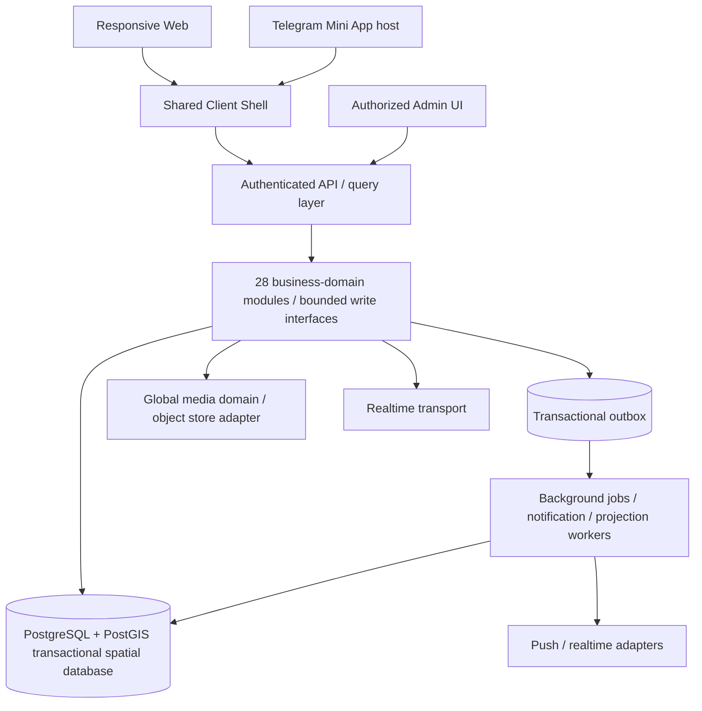

# VibeQuestGuardians — Structure.md

**Document ID:** VQ-STRUC-001  
**Status:** Revised architecture proposal for Product Owner review; not published or authorized for implementation  
**Date:** 2026-10-30  
**Destination:** `funmarket/VibeQuestGuardians` / `vibefoundation`  
**Companion:** `Requirements.md` (product contract); domain ownership register `docs/product-design/02_DOMAIN_OWNERSHIP_FINAL_LEAN.md` (canonical 28-row domain identities, pending its formal approval).

# Post-Baseline Architecture & Ownership Updates — Master Plan Controlled

> **Authority notice:** This document remains the architecture/domain/module baseline. After Product Owner approval of `Master Plan.md`, newer explicit Product Owner decisions and approved Master Plan implementation/operational architecture control execution where they supersede conflicting, incomplete, OPEN/UNSPECIFIED or absent older wording. Latest explicit Product Owner direction remains highest authority; the approved Master Plan controls implementation sequencing and newer operational architecture below it.

## Structure Delta A — Master Plan execution authority

The approved `Master Plan.md` is the consolidated living implementation and production-control authority. This Structure remains the canonical architecture baseline unless a newer explicit Product Owner decision or approved Master Plan clarification supersedes a point for execution. A newer operational/implementation detail is not a contradiction merely because this older baseline did not describe it.

## Structure Delta B — Admin Control Room architecture

The Admin Control Room is a first-class application surface and dedicated frontend/application orchestration module. It is progressively built, protected by scoped Admin authorization, uses canonical owner-domain commands, reads authorized projections and emits privileged audit records. It is **not** direct SQL, an unrestricted god-mode subsystem or a second writer.

## Structure Delta C — Admin Control Room is NOT D29

> **Admin Control Room is not D29.** Its screens and application orchestration may have dedicated modules plus cross-cutting audit/operations infrastructure, but canonical business records remain owned by D01–D28. Admin commands invoke those owners rather than maintaining shadow copies or second-writer tables.

Examples of canonical authority remain:

- D01 → Admin identity/capability associations and authentication authority
- D05 → Place truth and confidence
- D07 → Guardian/Legend eligibility
- D09 → Business/operator authority
- D20 → VQ rules, postings, grants and corrections
- D21 → reports, cases, sanctions and appeals
- D24 → Advertising
- D25 → subscriptions/entitlements
- D26 → Marketplace
- D28 → Ticketing

## Structure Delta D — Dedicated Admin application/platform module

Although it is not a business domain, Admin has its own implementation boundary for navigation, dashboard composition, scoped role/capability checks, owner-domain command invocation, authorized read projections, case workflows, privileged audit visibility and read-only operations visibility. That application/platform module does not own the underlying business facts it manages.

## Structure Delta E — Admin authorization ownership

D01 owns the canonical identity/authentication records and the role/capability associations used to authorize privileged Admin sessions/actions under the established architecture. Admin UI consumes server-validated capabilities; no UI-only elevation or hidden client-side privilege is valid.

## Structure Delta F — D21 Trust & Safety ownership

D21 is the canonical owner of reports, moderation cases, assignments, investigation/decision state, strike records, capability restrictions, suspensions, bans, appeals and moderation case history. A report alone is not punishment. Source domains remain owners of their own content/business state and execute source-record changes through their own commands when D21 decisions require them.

## Structure Delta G — Progressive Admin sequencing

The permanent Admin product grows with the owning domains rather than starting at the end:

- **S02** → permanent Admin shell and scoped authorization/RBAC
- **S05** → Reports & Cases core
- **S06** → VQ rules/ledger/grants
- **S08** → Places/Validate/D05 confidence policy
- **S10** → Guardians/Tours/Handshakes/reviews/entitlements operations
- **S11** → Social Content/Communities/Live Rooms moderation
- **S12** → Vibe/Pulls/VibeCheck/VibeFlash operational moderation
- **S13** → Activities/Events/Ticketing operations
- **S14** → Marketplace operations/disputes/reviews
- **S15** → integrated Control Room completeness, Dashboard, Users, Businesses, Advertising, full Trust & Safety, audit and global operations

These are permanent panels of one Control Room, not temporary throwaway screens.

## Structure Delta H — Messaging sequencing

S05 establishes the real D14 messaging engine, D23 delivery infrastructure, D21 report core and source-context authorization contracts. Source-specific conversation contexts reach full staging acceptance only when their source owner exists:

- Guardian consultation → S10
- Community chat → S11
- confirmed-Vibe personal DM → S12
- Event discussion → S13
- Marketplace negotiation chat → S14

No fabricated source-domain record may be created merely to claim D14 acceptance.

## Structure Delta I — Marketplace review ownership

- D22 owns Handshake issuance, the server-authoritative **ACTIVE → EXPIRED** lifecycle, exact **24-hour** expiry and review-eligibility proof only; there is no Handshake cancellation state.
- D26 owns Marketplace product/deal-item review content for the eligible Marketplace journey.
- D19 continues to own established Guardian/provider reputation review content.
- No new review domain is introduced.

## Structure Delta J — Privileged audit infrastructure

Cross-cutting privileged-action auditing may exist as application/platform infrastructure without becoming a business domain. Audit entries may record actor, validated capability/role, target, linked case/report, action, reason, owning-domain command, result/failure, timestamp and correlation/causation ID. Audit infrastructure records privileged execution history; it does not become the canonical writer of the business facts being changed.

## 1. Purpose, scope and architectural decision hierarchy

This document defines **how to organize the new application**, not what the product experience should be or the SQL schema. `Requirements.md` specifies the intended UI/UX and behavior recovered from `vibequest-fixed-v2 (2).zip`, the attached source-behavior narratives, and Product Owner decisions. The ZIP is **behavior and visual reference, not reusable engineering authority**. Historical Gemini's suggested structure/schema are **ideas**, not accepted configuration, schema or deployment evidence.

**Engineering objective:** preserve Home / Explore / Share / Vibe / Purse, their distinct sections and modal journeys, and the original aesthetic while rebuilding with genuine authenticated records, server-owned invariants, real media, notifications, geolocation and transactions. Avoid silent feature removal because a legacy function was fake. No fake users, seeded production interactions, mock payments, success-on-failure fallbacks or localStorage pretending to be business authority.

**Decision precedence:** newest Product Owner direction → accepted requirements → authoritative 28-domain ownership → historical observable UX → proposed implementation. Where no implementation choice is approved, this document specifies a testable architecture option rather than pretending a provider or technology is locked. **All 28 logical domains are in the target initial application; logical domains are not 28 databases, deployables, teams or migrations.**

## 2. Architectural approach and deployment topology

**Recommended architecture: modular monolith with explicit domain boundaries**, plus separately runnable asynchronous worker(s) and a single shared Web/Telegram client. This is a recommendation to approve at Structure review, not a statement that the current repository already implements it. It minimizes premature distributed-systems complexity while retaining extraction seams for scaling. Each module controls business mutations and exports intentional application interfaces; cross-domain reads can use authorized query projections.



- One canonical backend for browser and Telegram; Telegram identity must be validated server-side, and a host adapter provides theme, back-button, viewport and haptics. Telegram cannot own a second ledger or user directory.
- API serves authenticated commands and permission-aware reads; reads do not bypass business invariants or reveal private data. No direct client SQL/DB credentials.
- Start with one transactional database where appropriate. A separate event broker, external cache or multiple services should be adopted only on measured need; events alone do not replace durable transactional correctness.
- Workers handle deadlines, deduped event delivery, geofence processing, media retention, notification retries and reporting; server timestamps and persistence determine truth, not client timers.
- Admin is a **privileged application interface** to domain commands and audit logs, not a 29th business writer.

## 3. Proposed repository organization

The following is a **target logical layout**, not a claim these paths exist or a command to regenerate the repository. Retain/refactor current authorized files rather than deleting established work. Names are illustrative; approved coding conventions can tune path labels without changing boundaries.

```text
/
  AGENTS.md
  Requirements.md                 # product: what and why; publish only on approval
  structure.md                    # engineering organization and interfaces
  Database.md                     # later: actual data model, constraints, migrations
  docs/
    product-design/              # approved product and domain decisions
    architecture/                # ADRs, contracts, system diagrams, threat model
    ux-parity/                   # ZIP screen/interaction mapping; not application source
    operations/                  # runbooks, environment/deployment procedures
  apps/
    client/                      # one responsive browser + Telegram frontend
      src/
        app/                     # boot, routing, providers, auth session
        shell/                   # five equal nav tabs, header, overlays, global drawer
        pages/
          home/                  # view composition only
          explore/
          share/
          vibe/
          purse/
          profile/
          admin/                 # permission-gated, not publicly routed
        features/               # one cohesive user-facing responsibility per feature
          home-location-context/
          home-checkins/
          home-feeds/
          home-activities/
          home-events/
          home-streak/
          home-cultural-passport/
          home-guide/
          find-hub/              # contacts, mutual consent, lock-on, geofence views
          explore-map/
          explore-search/
          explore-radar/
          place-details/
          place-validation/
          secrets-board/         # multi-hour pop-ups, not 33s VibeFlash
          trail-directory/
          trail-studio/          # Overview, Stops Builder, edit/reorder/publish
          trail-detail/
          trail-city-discovery/ # creator/public-Trail and city-scoped Trail/Tour read projections
          trail-navigation/
          trail-adoption-remix/  # adopt, derivative edit, attribution, remix tree
          guardian-directory/
          guardian-onboarding/
          guardian-profile/
          guardian-consultation/
          guardian-hire/
          tour-authoring/        # create from scratch or adopted/existing Trail
          tour-detail/
          tour-reservations/
          share-composer/
          share-camera-capture/
          share-media-composition/ # PIP, mood filters, preview, retake
          share-publishing/
          nearby-vibes/
          join-vibe/
          aesthetic-echoes/
          vibecheck/             # independent 180s challenge UI
          vibeflash/             # independent 33s challenge and Mosaic UI
          gossip/
          drift/
          pulls/
          vibes-connections/
          orbit-following/
          echo-followers/        # distinct from Share aesthetic Echoes
          polar-matching/
          activity-matching/
          direct-messaging/
          community-directory/
          community-membership/
          live-rooms/
          notifications/
          vq-wallet/
          vq-ledger-history/
          vq-tipping/
          marketplace-listings/
          marketplace-deals/
          ticketing/
          advertising-placements/
          profile/
          admin/
        platform/
          web/                   # browser host/secure-context capability adapters
          telegram/              # Telegram WebView host adaptation only
          permissions/
            permission-coordinator/ # feature-scoped request/deny/revoke lifecycle
            location-permission/
            camera-permission/
            microphone-permission/
          devices/
            geolocation/        # shared Web/Telegram host location source, accuracy, freshness, failures
            camera/             # tracks, lenses, capture, lifecycle, cleanup
            microphone/         # capture/stream authorization and cleanup
            capture-session/    # bounded multi-device capture sessions
          map-rendering/         # MapLibre-backed presentation; no business ownership
          map-tiles/             # replaceable MapTileStylePort / style-source adapter
          external-poi/          # ExternalPoiDiscoveryPort; current Overpass adapter
          geocoding/             # provider-neutral search/reverse-geocode adapter
          external-navigation/   # ExternalNavigationPort to device Google Maps/Waze/other supported apps
        ui/                      # accessible design primitives, tokens, i18n, RTL
        data-access/             # typed API clients and cache invalidation
    api/
      src/
        app/                     # process boot, HTTP routing, auth middleware
        modules/                 # 28 logical domains; see section 4
        read-models/             # public/authorized Home, Explore/search feeds; PostGIS-backed spatial projections where permitted
        interfaces/              # HTTP routes, realtime contracts, webhooks
        platform/                # logging, clock, config, access policy, SQL driver
    worker/
      src/                       # durable schedules, outbox/inbox and retries
  packages/
    contracts/                   # versioned API/event schemas and explicit errors
    design-system/               # optional reusable primitives and tokens
    testing/                     # fixtures restricted to tests; no production fakes
  database/
    migrations/                  # Database.md-derived versioned migrations
    seed/                        # explicitly identified safe reference catalog ONLY
  .github/workflows/             # CI checks; releases after approval
```

**Binding feature-boundary rule:** Every independent user-facing experience has an explicit feature owner and cohesive state/interaction boundary; a page composes features and must not recreate legacy 700–1,100-line orchestration components. Feature folders above are a readable proposed mapping, not a fixed number of files or separate backend domains. Shared components remain reusable without merging feature responsibilities; a component's scope is evaluated by cohesion and dependencies, not arbitrary line limits. Each feature defines its public entry point, internal presentation/state/capability adapters, required domain commands/queries, loading/denied/failure states and permitted cross-feature navigation. No feature imports another feature's private state or persistence implementation. Domain commands always go through authorized typed contracts.

**Legacy code adaptation contract:** Inspect the exact original control and dependency chain; recover the user-visible purpose; distinguish usable bounded algorithms/presentation techniques from simulation and backend coupling; adapt only verified useful logic into the new owner's interface and test it in isolation. Never copy old screens/services wholesale or port their localStorage, Firebase/Firestore, fallback accounts, mock coordinates, fake media, simulated messaging, auto-accepted reservations or pretend credits. A broken backend is a reason to implement the behavior properly, never to omit the user-facing feature.

## 4. Canonical 28 business modules and single writers

The names/ownership below mirror the **current new-repository domain register**; the domain **identity and responsibility** outrank Gemini's suggested folder labels. Proposed directory keys do not grant new domain ownership.

| ID | Proposed module key | Sole domain-owned business state |
|---|---|---|
| D01 | `identity` | Accounts, sessions, credential/Telegram links, recovery |
| D02 | `profiles` | Public presentation, custom interests, privacy-scoped optional contact-channel fields, profile completion-assist preference, localization/accessibility settings |
| D03 | `social-graph` | Follow/block relationship records |
| D04 | `geo-presence` | Consented location evidence, freshness, geofences and proximity assertions |
| D05 | `places` | Places, check-ins, contributions, validation observations |
| D06 | `trails` | Trail itinerary, stops/order, lineage, edits and public versions |
| D07 | `guardians` | Local Legend/Pro eligibility, live selfie freshness, qualifications, offers |
| D08 | `tours-reservations` | Guided Tour offer/bookability, slots, requests, acceptance/decline/cancel |
| D09 | `businesses-organizations` | Verified organizational identities and operator permissions |
| D10 | `activities` | Community activities, schedules, participation, resonance eligibility |
| D11 | `events` | Organizer Events and RSVP, independent of tickets |
| D12 | `social-content` | Posts, ephemeral Vibes, Gossip, reactions/comments, visibility |
| D13 | `global-media` | Asset uploads, verification metadata, variants, visibility and lifecycle |
| D14 | `messaging` | Direct and contextual conversations, messages, receipts |
| D15 | `live-rooms` | Live room sessions, participant/speaker state |
| D16 | `communities` | Vibe Circles, membership, invitation and community permissions |
| D17 | `matching` | Drift, Pulls, bilateral confirmation, specialized match proposals |
| D18 | `challenges` | VibeCheck/VibeFlash initiation, deadlines, responses, Mosaic entitlement |
| D19 | `recognition` | Badges, Passport recognition, reputation, Guardian/provider review content; review eligibility proof remains D22-owned |
| D20 | `vq-ledger` | Reward rules, awards, transfers if approved, reconciled balances, admin grants |
| D21 | `moderation` | Reports, restrictions, enforcement and appeal |
| D22 | `handshakes` | Idempotent qualifying agreement/Handshake records and review access proof |
| D23 | `notifications` | Notification inbox, unread state, preferences, delivery attempts |
| D24 | `advertising` | Sponsorship/campaigns/placements and impression accounting |
| D25 | `subscriptions` | Plan lifecycles, subscription and access entitlements |
| D26 | `marketplace` | Peer listings, buyer/seller offers, negotiation and deal status |
| D27 | `payments-billing` | Real-money payment records, reconciliation, refunds, billing |
| D28 | `ticketing` | Independent ticket inventory, issuance, validation/admission |

**Cross-domain coordinator:** one explicitly named application-level use-case orchestrator coordinates multi-owner commands, without becoming a second authoritative writer; transaction/outbox boundaries and idempotency remain domain-owned. **Domain internal pattern (when complexity warrants):** `domain/` for invariants/entities, `application/` for commands and read interfaces, `infrastructure/` for persistence/transport adapters, `interfaces/` for API/message handlers. Do not force empty four-layer boilerplate into simple modules. Each authoritative business entity has one mutation entry point. Modules reference canonical IDs through explicit contracts; cross-domain operations coordinate via a use case with an owned transaction or outbox, not direct table writes from unrelated modules.

## 5. UI composition and original product parity

Treat the ZIP as source of **visible capabilities, choreography, labels and design character**. Specifically retain interactive, contextual flows rather than copying former component nesting:

| Destination | Composed capabilities / cross-page relations | Primary domains consumed |
|---|---|---|
| **Home** | City calibration/search; check-in carousel; live Secrets banner; My Network/Local Vibes/For You; activities/events; streak; Heritage coordinates; Local Gems; VIBE Guide; live feed; Find Hub contact/geofence/history | D02–D05, D10–D12, D16, D19–D20, D23 |
| **Explore** | Search/map/category radar; Places and Waze-style Yes/No/Not Here Validate; Secrets; Trail creation/remix/route/offline; paid Tour cards; Pro/Legend Guardian directory, hiring from Trail and consultations | D04–D09, D11, D13–D14, D20, D22–D23 |
| **Share** | Emotional pillars; live/dual camera, photo/video, moods; 24h Stream, Join Vibe, Echoes; VibeCheck180s, VibeFlash33s/Mosaic; Circles and gratitude | D04, D12–D13, D15–D16, D18, D20, D23 |
| **Vibe** | Gossip and inline post/engagement, Drift 12 wavelengths, Pull invitations, Vibes accepted matches, Orbit/Echo follow state, Polar/Social match modes and messaging | D02–D03, D12–D14, D17, D23 |
| **Purse** | VQ balance/rules/ledger; send/receive only as approved; genuine scannable Traveler Code concept; marketplace browse/list/negotiate/mark completed with genuine deal state | D01–D02, D14, D20, D22–D23, D26–D27 |

Preserve equal tab sizing, mobile-first Midnight Obsidian/neon styling, visible state transitions, navigation, gestures, modal workflows, deep links, error/retry, empty states, Telegram adaptation and EN/FR/AR with RTL. Share heart is **not** a floating/oversized separate action under current requirements. A feature's entry point may appear in several screens, but all points reference the same authoritative business object. Former ZIP paths (`src/screens/ExploreScreen.tsx`, `src/features/explore/components/CreateTrailModal.tsx`, `TrailDetailModal.tsx`, `VibeGuardians/*`, `src/features/home/components/FindHubModal.tsx`, `src/components/chat/VibeCenterView.tsx`, `src/features/crypto/components/CryptoDashboard.tsx`, etc.) are **mapping references**, not paths to transplant.

## 6. Interfaces, transactional truth and cross-domain flows

- **Commands** express intent (`SubmitPlaceValidation`, `PublishTrail`, `AcceptGuardianRequest`, `PostVqAward`, `SendMessage`, `ConfirmMarketplaceDeal`, `RedeemTicket`). Each validates identity/permissions, updates its canonical domain, and returns authoritative status/errors.
- **Queries** compose permitted projections for Home, Explore, Vibe, profiles and admin. They also support Trail creator/profile discovery and city-scoped public Trail/Tour discovery by joining permission-aware D01/D02 identity/profile presentation with canonical D06 Trail and D08 Tour reads; these projections never write or duplicate the source records. Projection lag must be transparent where users need confirmation of a consequential change.
- **Events** represent committed facts, not instructions to mint credits. Event envelopes include stable IDs, source domain, schema version, actor/subject, occurrence time and causal correlation. Producers persist domain changes and outbox atomically where necessary; consumers idempotently process and can replay safely.
- **Guardian capacity boundary:** D07 owns configurable optional maximum active-client capacity and offer eligibility; D08 alone owns pending/accepted engagements and capacity reservation at real Guardian acceptance. Frontend Hire green/available versus red/disabled is a truthful projection of those facts, not a booking transition. A null/unset cap is not treated as capacity zero.
- **Six Vibe primitives:** D12 canonical Gossip posts, including any optional consented canonical Place reference or coarse-area presentation tag without copying precise live-location evidence into public content; D17 canonical Drift proposals, pending Pull invitation/decision and confirmed double-opt-in Vibes; D03 one directed follow record viewed outbound as Orbit and inbound as Echo. D17 Pull acceptance **or a D18-verified completed reciprocal VibeCheck** may establish exactly one confirmed Vibe, including for previously unconnected eligible participants; D03 reciprocal following and Gossip engagement never do. D18 alone validates both genuine responses, authorized participants and server deadlines, then invokes D17’s idempotent mutual-confirmation contract; invitation acceptance, a unilateral response, skipped/refused/expired challenges and collective VibeFlash do not create Vibes. D14 ordinary personal DMs require confirmed Vibes, with separate bounded Guardian consultation, Community room, Marketplace deal and Event discussion contracts. D18 owns one-to-one VibeCheck invites/decisions/response/reveal, validates the retained **1–60 character** prompt bound, and separately owns collective VibeFlash participation; eligibility derives from independently verified relationship/Pull/community permissions, **not location**. D16 owns Community roles/invitations; D23 owns notification delivery, not the source transition. D22 records qualifying accepted agreement Handshakes only for approved source journeys, including eligible Guardian/Legend/Tour engagements and the separately governed Marketplace deal agreement; D20's default +75 VQ rule applies only to an eligible Guardian/Legend service Handshake, not Vibe formation or a Marketplace deal Handshake.
- **Cross-domain orchestration:** a place validation is owned by D05 using D04 evidence; D20 independently evaluates configured award eligibility. D08 records the applicable pending Guardian/Legend engagement or Tour reservation; on an eligible Pro Hire, free Local Legend Meet/Vibe, or Tour reservation acceptance, D22 issues exactly one Handshake for that qualifying accepted agreement. The Handshake is not physical GPS/QR proof, payment proof or service-completion proof. D23 routes notifications without creating the booking. D27 is a future-only payment-integration boundary, **not** an active launch payment processor; D08/D28 use their own authorized acceptance/issuance contracts and do not fabricate fiat settlement for seller-direct/cash services. Ticketing D28 may operate without D11 Event linkage.
- **Failure semantics:** no happy-success UI after failed authoritative writes; preserve pending/failed/retry states, prevent duplicate submissions, handle timeout and late update, and reconcile eventual delivery separately from the committed business transaction.
- **Admin:** auditable rule edits and grants call D20 commands; staff roles cannot edit the ledger through direct SQL shortcuts. Similar principle for moderation, guardians and subscriptions.

## 6A. Reusable device permissions and consent boundary (mandatory)

**Binding rule:** geographic location, camera and microphone are three independently requestable permissions. A feature may explain why access is requested; only the relevant browser/operating-system/Telegram host can grant its hardware capability. An in-app Apply toggle never substitutes for an actual device grant. Permission status is assessed on use and after host foreground/resume where supported, not permanently assumed from a saved preference. 

| Capability | Consuming frontend features | Shared infrastructure vs business authority |
|---|---|---|
| Location | Home city, Explore map/radar/Place validation, Find Hub mutual presence/geofences, Share opted-in geotag, nearby discovery | Browser geolocation and supported Telegram location capability feed one shared device-location adapter. It reports coordinates only with actual accuracy/freshness or truthful denial/unavailability; D04 authorizes consent, evidence, precision and proximity. Manual city/area is discovery context, not verified presence. D03 follow/block and feature privacy settings constrain sharing. |
| Camera | Share live shot and dual sequential capture, Guardian recurring in-app selfie, VibeCheck/VibeFlash capture, eligible Join Vibe | Device adapter opens/stops tracks and reports actual availability; D13 manages validated media; D07/D18 govern selfie/challenge eligibility. Never synthesize a proof photo on failure. |
| Microphone | Video-with-sound, voice notes, eligible Share Echo audio, live-room voice | Device adapter requests/cleans up streams; D13 manages uploaded recorded audio; D14 messages and D15 realtime rooms own their respective communication authorization. No recording of live-room audio by default. |

**Required shared states:** not requested, explanation shown, requesting, granted, denied, blocked/unavailable, temporarily interrupted and revoked (host APIs may not expose all states; do not falsely claim detection). Handle browser secure-context constraints and Telegram WebView differences, per-feature retries, user-readable settings guidance, and consistent resource cleanup on exit, cancellation, logout and device change. No one-time global permission grant is a substitute for feature-specific consent. Declining microphone must not prevent independent location-only browsing; declining location must not invent GPS or silently share exact coordinates. Background location tracking is not implied by normal geolocation permission.

**Permission + privacy flow:** user intention → feature rationale → host permission request → actual hardware availability → feature-specific user opt-in → server-side authorization/evidence where relevant → canonical business effect. Disabling Find Hub sharing, revoking access or blocking a contact must stop further disclosure independently of operating-system GPS permission. Location, camera and microphone APIs are testable via adapters with explicit *test-only* fake capabilities that never enter production.

## 6B. Trail authoring, adoption, remix and Tour composition

- D06 owns free Trails from any eligible authenticated member, ordered stops, publication/versioning, adoption/remix, immutable original attribution and lineage. `trail-adoption-remix` creates a separate derivative; no overwrite of the original author record. Multiple screens use the same Trail identity and deep-link contract.
- Eligible Pro Guardians may start a commercial Tour from scratch **or adopt an existing Trail or remixed derivative** into the Tour-authoring experience. The existing Trail remains a free, attributable Trail; D08 owns commercial Tour offer details, bookability, rates, dates and reservations, with D07 and D25 determining Pro entitlement/eligibility.
- `Label this as a Tour` is an eligible authoring interaction, not a conversion that deletes or appropriates the source Trail. Tour itinerary can reference the appropriate Trail version or maintain an explicitly attributable itinerary derivative under D06 contracts; the exact persisted representation belongs to Database.md, not an agent-invented new product policy.
- A Pro Guardian can be hired to guide an **existing free Trail** without first forcing it into a published commercial Tour. Context and Trail identity travel through D08's accepted-request flow; D22 records one eligible Handshake on actual acceptance, not on opening the Hire UI.
- **Creator discovery journey:** `trail-detail` / Trail cards expose the creator username/avatar as navigation into the existing `profile` feature, which resolves the canonical D01 member and D02 presentation. That profile consumes a permission-aware D06 query for the creator's eligible published Trails and may group/filter those canonical Trails by their real city/location context. The profile remains a reader; it does not own Trail lifecycle or persistence.
- **City discovery journey:** Trail card/detail city/location actions enter `trail-city-discovery`, preserving the selected authoritative city context and composing eligible public D06 Trails with D08 Tours. The surface exposes loading, mixed/Trails-only/Tours-only/empty, removed/access-restricted and retryable-failure states, then deep-links to the canonical Trail or Tour detail feature. Geographic context can consume D04/D05-authorized location/Place facts where applicable, but Geo/Places do not become Trail/Tour writers and no City business domain is introduced.

## 6C. Geo, map, external discovery and navigation boundaries — DIRECTED

**Canonical flow:** host-specific device capability → shared location adapter/permission boundary → **D04 Geo & Presence** → PostgreSQL/PostGIS-backed authorized spatial query/evidence → owning domain or read projection → UI. D04 owns consent, precision, accuracy/freshness, temporary presence, proximity assertions and geofence transitions; it does not become the writer of D05 Places, D06 Trails, **D07 Guardian/Legend service-area business rules**, D08 Tours, D09 Businesses, D10 Activities, D11 Events, D17 matches, D18 challenges or D23 notifications. D07 owns any configured Guardian/Legend service-area eligibility or offer boundary while consuming provider-neutral geographic context and D04-authorized spatial evidence/query results. PostGIS is the intended VibeQuest-owned spatial engine; exact types/index definitions remain Database/implementation work. Server-side `ST_DWithin`-style proximity querying is the intended pattern for protected/canonical distance operations—including applicable nearby canonical Places/Trails/Tours/Activities/Events, permitted presence/Find Hub queries and D07 service-area filtering—rather than downloading all coordinates and deciding authority in the client. Client Haversine remains presentation-only.

**Map presentation:** `MapLibre` is the intended interactive in-app renderer for Explore, Place pins, Radar results, Trail route/numbered stops, city Trail/Tour discovery, permitted Find Hub/geofence views and other approved map surfaces. A `MapTileStylePort` keeps style/tile sources replaceable; the current low-cost stage may use a compliant OSM-compatible source. Rendering, tile/style choice and camera state never own canonical geographic facts. Public OSM-compatible tile infrastructure must not be bulk/offline-prefetched where prohibited.

**External POI discovery:** `Explore/Radar query → backend/query cache and rate controls → ExternalPoiDiscoveryPort → current Overpass adapter → normalized real candidate results`. Requests are bounded, deduplicated, category/area scoped and not fired continuously for every pan/zoom. Public Overpass is a low-volume discovery dependency, not an SLA-backed canonical database. Provider-specific response shapes remain inside the adapter. A discovered OSM object remains an external candidate until D05 explicitly establishes a canonical Place; then ordinary VibeQuest reads/proximity use the canonical record instead of repeatedly treating the provider as owner.

**Geocoding:** address/search/reverse-geocoding use a replaceable provider port; the current stage may use a compliant OSM-derived provider. Provider IDs/provenance may be retained as metadata where permitted, but no `GooglePlace`, `OSMNode` or `OverpassResult` becomes a business owner. Manual city/district selection remains a browse context and cannot satisfy physical-presence proof.

**External navigation:** canonical D05 Place coordinates or canonical D06 ordered Trail stops → `ExternalNavigationPort` → supported device Google Maps/Waze/other navigation application. `Maps Route` / `Navigate Trail` may preserve the historical multi-stop Google Maps handoff when valid, but VibeQuest does not initially own turn-by-turn routing and opening the external app cannot itself complete a Trail, check in, create a Handshake or award VQ. A future routing provider seam may exist without provisioning OSRM/GraphHopper now.

**Truth and privacy:** provider failure permits valid cache, retry, partial/empty/unavailable/offline states only—never fabricated POIs, businesses, coordinates, contacts, movement, routes, ratings, crowd counts, arrivals or success. Device coordinates are untrusted inputs; PostGIS proves geometric relations between supplied facts, not human authenticity. Precise temporary location is disclosed only where specifically authorized; public/social surfaces receive coarse city/area or permitted approximate distance. Find Hub temporary pings retain the 2-hour maximum; blocking/revocation stops disclosure. The directed **23 km** Secrets/Find Hub/near-feed discovery scope is a query policy, not an individual geofence, Secret claim, Place check-in or D18 participation radius.

## 7. Data and database boundary — schema intentionally deferred

Structure chooses **PostgreSQL with PostGIS spatial capabilities** as the intended transactional persistence/query boundary for VibeQuest-owned geographic records and server-authoritative distance/proximity operations. Exact tables, SQL types, constraints, spatial indexes, migrations and provider/version details belong in later physical implementation work derived from **Database.md**. The database model follows domain ownership, real data sensitivity and transaction requirements; it is **not derived from Gemini's printed ERD**.

Proposed persistence partitions: private identity; public profile; consented ephemeral precise location with short retention and separate geofence rules; Places/check-ins; Trails/stop versions/remix links; Guardians/entitlements and Tour availability; social posts/media/reactions; conversations/rooms; challenge state; recognition; VQ ledger and rules; notifications; Marketplace; payments; independent tickets. Avoid shared write tables and invented cross-domain FKs that create circular service authority. A shared DB may enforce legitimate relational constraints while modules retain code-level write boundaries.

**Location proof is not inherently trustworthy GPS**: device latitude/longitude, EXIF and capture timestamps are untrusted inputs; use consent, accuracy, freshness, replay resistance, multi-device/anomaly handling and explicit evidence confidence. No claim of hardware watermark guarantee. PostGIS is authoritative for geometric distance/proximity evaluation over accepted evidence but cannot by itself establish that a human physically stands at a coordinate. For the directed Place check-in rule, D05 may accept only when D04 evidence is sufficiently fresh/precise to establish **within 5 m** of the canonical Place; the existing reported-accuracy-better-than-50-m condition is not sufficient by itself, and excessive uncertainty yields cannot-verify. Respect approved Find Hub temporary-ping retention, not permanent surveillance.

**VQ is internal reward accounting, not SOL crypto.** D20 must support auditable append-only posting, versioned Admin reward policies, uniqueness/idempotency, reversal entries and integrity checks. Whether double-entry is appropriate requires a concrete accounts/invariants design. Marketplace does **not** create an escrow module or commission path; a deal's physical handover is not silently proved by one click. No automatic P2P fiat/crypto exchange service is introduced by historical examples.

## 8. Media, camera, files and offline

D13 owns a media-asset lifecycle with signed/direct upload **as an option**, metadata/status, anti-malware/type validation, size limits, ownership, secure delivery, retention and deletion; choose S3-compatible provider only during infrastructure approval. **Each consuming business domain retains the meaning and authorization of its attachment relationship (who may attach, read or remove that media); D13 does not become a second writer of the feature record.** Camera/device adapter owns permission lifecycle, live front/back sequential capture, optional video duration, PIP reposition and mood filtering; approved Guardian selfie/camera challenges must not silently accept gallery/stock substitutes. Never assert a synthetic fallback is a genuine live capture. Actual proof eligibility is independently controlled by D07/D18 and evidence policy; image metadata alone cannot verify liveness.

- D06 Trail lifecycle distinguishes create/edit/publish, save/Passport, adopt/remix with original attribution and lineage/tree, verified completion, navigation and bounded authorized offline caching. D08 may link a Guardian request or Tour to an existing Trail without overwriting the Trail; D20 independently evaluates qualified completion rewards. D04 owns Find Hub geofence/transition evidence, while D23 owns delivery and inbox read/dismiss state. D20 Admin grant distribution selects individual/group/broad recipients, then posts idempotent per-recipient balanced ledger movements.
- Share Aesthetic Echo Circles (D12 content) retain creator-visible contributor actions **Add to Circle**, **Add to Community**, and **Form Community from this Circle**, carrying eligible originating context into D16 authorization. **Add to Community** enters an existing eligible Community selection plus D16 invitation/add-context workflow; **Form Community from this Circle** starts a new Community creation flow with eligible Echo context prefilled. No creator-only browser-local click can manufacture another member's consent, membership, Vibe relationship or VQ award; D16 owns actual Community creation/invitation/member transitions and Community presentation metadata such as name, handle, emoji/icon, mission, category and privacy. This is distinct from D03 inbound Echo followers.
- D16 Community lifecycle distinguishes discovery/directory, creation, invitations, private/public memberships, founder/moderator roles, member management and leaving/ban. D14 owns authorized Community chat/pins/polls and D15 room realtime/voice; D21 owns sanctions. A Community location label never gates D18 challenges.
- Trail save and offline access use **bounded local caching of authorized public content** with expiry, provenance and clear offline limitations. Treat Trail text/details, itinerary/stops, permitted media, map tiles and routing as separate capabilities. Cache map tiles only when the active source explicitly permits it; otherwise state that offline map tiles/routing are unavailable rather than claiming full offline mapping. No offline check-in, protected proximity decision, payment, Handshake or VQ award is finalized locally. Cache invalidation and access revocation protect private media/contacts.

## 9. Realtime, scheduling, geo events, notifications and search

- Short-lived VibeCheck (180 seconds) and VibeFlash (33 seconds) use server-created deadlines **without geographic/area-match participation gates**; client countdown is presentation. Multi-hour Secrets/Flash Events have their own lifecycle. Mosaic is accessible only to eligible responders per approved rule.
- A durable worker handles expired jobs, Guardian 7-day public-selfie eligibility, notification retries, short-lived media cleanup, reservation hold expiry, outbox deliveries and Find Hub geofence transitions. Jobs are idempotent and observable; no fixed cron frequency is silently locked.
- Realtime channels require authenticated membership and privacy checks. D14 private/Guardian/deal conversations are separate UI contexts using authorized records; D15 owns live room sessions. Do not infer a shared soundboard effect is broadcast unless room semantics and transport are explicitly specified.
- Search/discovery indexes are replaceable projections of Places, Trails, Guardians, Events and permitted content. Canonical spatial reads use PostGIS-backed authorized projections; external nearby POI discovery uses the separate `ExternalPoiDiscoveryPort`/Overpass path with bounded cache/rate controls. Radar and Home For You cannot invent popularity, ratings, crowd levels or fallback Places. Sponsored content is sourced and labeled through D24.
- D23 owns in-app bell, unread, deep links and delivery attempts. Delivery systems must respect privacy, mute/block rules, quiet hours if adopted, and real push capability; no fake populated notification feed.

## 10. Identity, authorization, privacy and trust boundaries

Single canonical account for browser/Telegram. The browser identity experience preserves member credential sign-in/registration and the source-visible **Google account sign-in** entry; D01 owns the authenticated external-provider linkage and server verification. Telegram `initData` verification remains a D01 host/linking path, not a separate profile universe. Keep passwords/session secrets inaccessible to public profile queries. Account claims and business/Guardian qualification are distinct. Restrict private location sharing, precise check-in evidence, media capture, DMs, profiles, bookings and payment details to actors with current permissions. Enforce permissions server-side, including admin operations, and use auditable rate limiting for sensitive writes. No user-controlled roles, mock current-user identity, client-only permission switches or auto-accepted reservations.

The existing `profile` frontend feature composes the source-visible Sync/Device Settings, Security/Identity-status and Help/Support entry points. D02 remains the writer for personal preferences/presentation, D01 for authentication/security/link state, and D21 only for scoped trust/moderation restrictions where applicable; Help/Support is navigation/content rather than a new business writer. Placeholder alerts or local developer diagnostics do not satisfy these entry points.

D22's Handshake qualifies on the accepted agreement defined by each approved source journey: an eligible **Pro Hire**, **free Local Legend Meet/Vibe**, or accepted **Tour reservation** as applicable, plus the separately governed eligible **Marketplace mutual deal agreement** under D26/MKT-002. It is **not proof of co-location, physical meeting, payment settlement, physical handover or service completion**. One accepted source agreement cannot mint more than one Handshake, even after retries; review gating follows its approved eligibility rule. A social Pull acceptance or Vibe formation is a D17 connection event, **not** D22 proof. The default +75 VQ rule applies only to the eligible Guardian/Legend service Handshake and is not inherited by a Marketplace deal Handshake. Preserve the Guardian 111-character review and exactly one Good/Chill/Cool badge.

Moderation D21 can restrict harmful accounts/content; D02 manages settings; D19 recognition never converts balance into trust/authority; subscriptions D25 can gate paid Pro visibility but cannot validate identity by payment alone.

## 10A. Mandatory document architecture-conformance gate

Before calling this Structure proposal ready for Product Owner approval, verify independently against Requirements.md and the established 15-rule VibeBehaviorGate: (1) no mega-feature implementation, (2) distinct UI feature homes, (3) single writers for all 28 logical domains, (4) defined coordination interfaces, (5) legacy UX and deep-link preservation, (6) Trail adoption/remix and Pro Tour reuse, (7) location/camera/mic permission lifecycles, (8) Web/Telegram shared product and verified identity, (9) independent media/DM/rooms/notification owners, (10) no fake authoritative outcomes, (11) all five equal tabs and accessible responsive design, (12) no reopened settled policy. Resolve source-verifiable contradictions in the current draft, never present an old rule as a new suggestion. Do not claim a runtime test or complete button inventory merely because architecture checks pass.

## 11. Operations, quality gates and release sequence

**CI:** formatting, types, lint, dependency/security checks, schema/contract compatibility, unit tests of invariants, module boundary import rules, migration checks and representative client component tests. **Integration:** independent test users, Web and Telegram account linking, real read/write authorizations, live place proximity evidence, Trail remix attribution, Guardian acceptance and exactly-one Handshake, VQ idempotency, Find Hub consent revocation, challenge expiry, messages delivery/failure, Marketplace deal state, media deletion and independent Ticketing redemption. Use clearly marked synthetic fixtures **only** in isolated tests/staging; never seed fabricated user activity as production reality.

**Observability:** structured logs with correlation/causation IDs, outcome metrics, privacy-safe tracing and immutable privileged audit records. **Readiness:** distinguish API liveness from database/migration/media/worker dependency compatibility; avoid declaring a deploy healthy because the process runs. **Release:** migration compatibility, versioned contracts, explicit rollout/rollback, verified worker and client backend compatibility. Do not encode automatic deployment or GitHub publishing without permission. No source/requirements document is proof of deployed functionality.

**Acceptance of architecture (not app build):** prove that the proposed module map accounts for all 28 canonical domains; each cross-domain example has one writer; all five original navigation destinations and high-value interactions have client composition locations; Web/Telegram share one authority; design separates privacy, billing, VQ and reputation; backend mechanics not prematurely fixed; open provider decisions are recorded without being invented. Future implementation tests then prove runtime behavior.

## 12. Gemini proposal: reuse decisions and explicit rejections

| Suggested concept | Architecture disposition |
|---|---|
| Domain-oriented server modules, layered business logic | **Adapt** as bounded modules, avoid boilerplate/28 deployables |
| React responsive client and Telegram SDK adapter | **Candidate**, confirm existing repository and target stack before hard lock |
| PostgreSQL + PostGIS | **Directed target** for VibeQuest-owned spatial records/proximity; verify provider/version/extension, spatial indexes and operational needs during implementation |
| MapLibre interactive rendering | **Directed target** presentation adapter; canonical domains remain owners of geographic facts |
| OSM Overpass external POI discovery | **Directed current low-cost adapter**, bounded/cached/rate-controlled and replaceable; never canonical Place authority |
| OSM-compatible map style/tile source | **Directed current low-cost seam where compliant**, replaceable and not bulk/offline-prefetched when terms prohibit it |
| External device navigation | **Directed target** for Place/Trail directions through provider-neutral handoff to Google Maps/Waze/other supported apps; no in-app turn-by-turn engine required initially |
| Transactional outbox, workers, storage adapter | **Retain principles**, choose mechanisms during detailed design |
| 28 migration files and mandatory four layers for every domain | **Reject as arbitrary file counts**, derive migrations and layers from functionality |
| Fixed 412-px app shell and mandatory view <250 lines | **Reject as universal constraints**, require responsive UX and maintainability instead |
| 10-m GPS + QR physical Handshake | **Reject**: an accepted eligible in-app service engagement (Pro Hire, free Legend Meet/Vibe or eligible Tour reservation), or the separately governed eligible Marketplace mutual deal agreement, may define a D22 Handshake under its approved journey; none is physical-meeting, handover or payment proof, and Marketplace does not inherit the service +75 VQ rule |
| Marketplace VQ escrow, release on QR and fee | **Reject**: direct seller, no escrow, no commission |
| GPS metadata/hardware watermark guarantees live authenticity | **Reject guarantee**: device data untrusted, risk-controlled evidence required |
| Account role solely from `role` column | **Revise**: separate identity, Guardian qualification, subscriptions, organization authority and admin permissions |
| Single container guaranteed Railway readiness | **Reject guarantee**: deployment topology and readiness require actual environmental proof |
| Historical SOL/Devnet crypto UI | **Exclude** from approved economy; preserve Purse intent using real VQ |

## 13. Design decisions to settle in Structure/Database phase (without reopening Requirements)

1. Target toolchain/repo workspaces and runtime versions, based on current branch and explicit owner choice; do not adopt Gemini's Node/Vite/Fastify by default.
2. API protocol, typed schema, realtime transport and service-to-client authentication; preserve Web/Telegram single authority.
3. PostgreSQL/PostGIS **provider/version, migration, spatial-index and operational policy**; PostGIS itself is now the directed spatial capability, while exact table/index/transaction design remains deferred to Database.md/implementation. Map tile, geocoding and external-POI providers remain replaceable adapters.
4. Durable outbox/worker implementation and exactly-once *effects* through idempotency (not a false exactly-once transport claim).
5. Media object store and privacy/retention; live-capture threat model and approved proofs.
6. Billing/entitlement providers, Ticketing and Marketplace safety boundaries consistent with accepted scope.
7. Operational configuration, privacy compliance and staging/release security controls.

These are **engineering selection tasks**, not missing product features. Product Owner approvals are requested for material vendor, budget, privacy and commercial decisions; ordinary bounded implementation detail remains the engineering team's responsibility after authorization.

## 14. Sources and verification notes

- **Authoritative for new product direction under certification:** local `/mnt/data/Requirements.md` (current local certification candidate containing directed/accepted Product Owner rules); new repository branch `vibefoundation` `AGENTS.md`, `docs/product-design/00_SOURCE_BASELINE.md`, `01_PRODUCT_DECISIONS_AND_IDEAS.md`, `02_DOMAIN_OWNERSHIP_FINAL_LEAN.md` read at branch commit `8d266d7a221f73520f54a8d304f71be37ce0e6a4` (2026-10-30 inspection). These repository documents retain their own approval-status caveats, and the exact local candidate still requires Product Owner approval before GitHub adoption.
- **Historical reference:** `/mnt/data/vibequest-fixed-v2 (2).zip`, 212 application TS/TSX files with real feature/interaction entry points, including `src/screens/*`, `src/features/home/components/FindHubModal.tsx`, `src/features/explore/components/CreateTrailModal.tsx`, `TrailDetailModal.tsx`, `TrailRemixTree.tsx`, `VibeGuardians/*`, `src/components/chat/VibeCenterView.tsx`, `src/features/share-good-vibes/components/*`, `src/features/crypto/components/CryptoDashboard.tsx`, and `src/features/admin/components/AdminConsole.tsx`.
- **Historical behavior and risks:** `/mnt/data/VIBEQUEST_LEGACY_SAFE_BEHAVIOR_EXTRACTION_EXPLORE_SHARE_HOME_GENERAL_PURSE_2026-10-30.md`, `/mnt/data/vq_audit/AUDIT_FINDINGS.md` and control inventory. Mock mechanisms are evidence of desired UX, never of trustworthy current infrastructure.
- **Non-authoritative proposal:** `/mnt/data/Pasted text.txt` and `/mnt/data/Gemini_Structure_Database_Proposal_Review_2026-10-30.md`. Their claims that files had already been created in GitHub or a specific Railway schema existed have **not** been adopted as proof.

**Document completion statement:** This is a revised **Structure.md review proposal**, not an approved implementation design, actual migration plan or runtime verification. No GitHub, database or deployment mutation was performed to create it. Product Owner may approve this architecture or direct targeted revisions before publishing.


## 15. Account category architecture — approved decision
**DIRECTED / APPROVED PRODUCT RULE (supersedes conflicting earlier account-category assumptions):** Vibe is the default member account category; Pro is for individual professional providers including artists, event planners and eligible Pro Guardians; Business is for business owners and authorized operators of restaurants, venues, theatres, stores and certified Places. Both eligible Pro and Business principals may publish official Events. Only an appropriately verified and authorized Business operator may claim, manage and publish its certified Business Place; selecting the Business category does not self-certify ownership or Places. A single canonical D01 identity may have Pro qualifications and operate one or more Businesses without duplicate user identities. Local Legend and Pro Guardian remain D07 qualifications, not additional top-level account categories. Category labels alone must not grant sensitive capabilities: D07 owns Guardian qualification, D09 owns organization/operator verification, D05 owns canonical Place publication, D11 owns Event lifecycle, D25 owns entitlement and D01 owns identity. D28 Ticketing remains independent of Events. Existing requirements for genuine authorization, eligibility, privacy and audit remain binding.

**REVISED PRODUCT OWNER CLARIFICATION:** D09 automatically certifies the eligible Business profile, ensures one profile per Business owner, and allows multiple branch addresses; D05 retains separate Place ownership/claim authorization. D11 publishes eligible Pro/Business Events immediately, with D21 subsequent moderation. This clarification does not add an account category or business domain.
